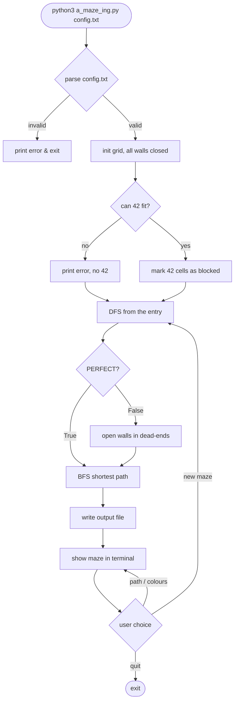

*This project has been created as part of the 42 curriculum by yanard.*

# A-Maze-ing

## Description

A-Maze-ing is a maze generator written in Python. It reads a config file,
generates a random maze, writes it to a file using one hexadecimal digit per
cell, and shows it in the terminal where you can play with it (new maze,
show the solution, change colours).

Every maze has a "42" drawn in the middle with fully closed cells, and the
program can make two kinds of mazes:

- **perfect** (`PERFECT=True`): exactly one path between any two cells, so
  only one way from the entry to the exit.
- **non-perfect** (`PERFECT=False`): a board that could be used for a
  Pac-Man like game - everything is connected, there are many loops and
  (almost) no dead-ends.

The generation part is a separate module, `mazegen`, that can be installed
with pip and reused in other projects.

The goal of the project is to practice randomness, graph theory (a perfect
maze is a spanning tree of the grid) and writing reusable, packaged code.

## Instructions

Requirements: Python 3.10 or later.

```sh
python3 -m venv venv
source venv/bin/activate
make install          # flake8, mypy, build
make run              # python3 a_maze_ing.py config.txt
```

Other Makefile rules:

| Rule | What it does |
|---|---|
| `make run` | run the program with `config.txt` |
| `make debug` | run it inside `pdb` |
| `make lint` | `flake8 .` and `mypy .` with the subject's flags |
| `make lint-strict` | `flake8 .` and `mypy . --strict` |
| `make build` | build the `mazegen` package and copy it to the root |
| `make clean` | remove caches and build folders |

You can also run it with any config file:

```sh
python3 a_maze_ing.py my_config.txt
```

### Controls

Once the maze is shown, type a number and press Enter:

```
1. Re-generate a new maze
2. Show/Hide the shortest path
3. Change wall colour
4. Change 42 colour
5. Quit
```

The entry is green, the exit is red and the path is cyan. Each new maze
is also saved to the output file. Ctrl-C or Ctrl-D quits too.

## Config file

One `KEY=VALUE` per line. Empty lines and lines starting with `#` are
ignored. Spaces around keys and values are allowed.

| Key | Mandatory | Description | Example |
|---|---|---|---|
| `WIDTH` | yes | number of columns, 1 to 200 | `WIDTH=20` |
| `HEIGHT` | yes | number of rows, 1 to 200 | `HEIGHT=15` |
| `ENTRY` | yes | entry cell as `x,y` | `ENTRY=0,0` |
| `EXIT` | yes | exit cell as `x,y` | `EXIT=19,14` |
| `OUTPUT_FILE` | yes | file where the maze is written | `OUTPUT_FILE=maze.txt` |
| `PERFECT` | yes | `True` or `False` | `PERFECT=True` |
| `SEED` | no | integer, same seed gives the same maze | `SEED=42` |

The default `config.txt`:

```
WIDTH=20
HEIGHT=15
ENTRY=0,0
EXIT=19,14
OUTPUT_FILE=maze.txt
PERFECT=True

# optional: same seed gives the same maze every run
# SEED=42
```

The program stops with a clear `Error: ...` message if the file is missing,
a line has no `=`, a key is missing, unknown or written twice, a value has
the wrong type, the entry or exit is outside the maze, on the "42" or both
are the same cell. If the maze is smaller than 9x7, the "42" can't fit: an
error is printed and the maze is generated without it.

## Output file

Each cell is one hex digit, where each bit is a closed wall:

| Bit | Value | Wall |
|---|---|---|
| 0 | 1 | North |
| 1 | 2 | East |
| 2 | 4 | South |
| 3 | 8 | West |

Rows are written one per line, then an empty line, then the entry, the
exit and the shortest path (`N`, `E`, `S`, `W`). For example, with the
default config and `SEED=42`:

```
D539553955553D517913
97C693C69553C53C56AA
...
EC545457C547C6C5546E

0,0
19,14
EESENEEESENEEEEESEESSENEEENNESSSSWWWSWNWSSSENESSSWSESSESSENNNESSS
```

## Maze generation algorithm

I used a **randomized depth-first search** (also called recursive
backtracker), written with a stack instead of recursion:

1. Start with all walls closed. The cells of the "42" are marked as
   blocked so the algorithm never enters them.
2. Put the entry cell on the stack and mark it as visited.
3. Look at the 4 neighbours (N, E, S, W). Keep the ones inside the maze,
   not visited and not blocked.
4. If there is one, pick it randomly, open the wall between the two
   cells, mark it visited and push it on the stack.
5. If there is none, pop the stack (go back) and repeat from step 3.

When the stack is empty, every free cell was visited exactly once, so the
maze is a spanning tree: fully connected and with exactly one path between
two cells. That's the perfect maze.

For a **non-perfect** maze, after the DFS:

- every dead-end (cell with only one open side) gets one more wall opened,
  in a random direction;
- a wall is never opened if it creates a 3x3 open area (corridors must stay
  at most 2 cells wide);
- on very small grids, if there are less than 2 loops, more random walls
  are opened until there are 2.

The shortest path is found with a **BFS** from the entry to the exit.

### Why this algorithm

- It's the simplest one to understand and to explain: a stack and a
  random choice.
- It runs in linear time, each cell is pushed once.
- It gives long, twisting corridors, which look nice and make a harder
  maze than Prim's or Kruskal's.
- The "42" was easy to add: blocked cells are just skipped.
- The non-perfect mode reuses it: start from a perfect maze, then open
  walls. This is easier than writing a second algorithm.



## Reusable code

The whole maze generation is in the `mazegen` package (`mazegen/`), with
one class: `MazeGenerator`. It doesn't depend on the rest of the project
(parser, display, output file).

The package is built as `mazegen-1.0.0-py3-none-any.whl` (and
`mazegen-1.0.0.tar.gz`) at the root of the repository. To build it again
from the sources:

```sh
python3 -m venv venv
source venv/bin/activate
pip install build
make build            # or: python3 -m build
```

Install it in another project:

```sh
pip install mazegen-1.0.0-py3-none-any.whl
```

### Basic example

```python
from mazegen import MazeGenerator

maze = MazeGenerator(20, 15)
maze.generate_maze()
print(maze.solution)
```

### Custom parameters

```python
maze = MazeGenerator(
    30, 20,            # width, height
    entry=(0, 0),      # (x, y)
    exit=(29, 19),     # (x, y), default is bottom-right
    perfect=False,     # loops and almost no dead-ends
    seed=42,           # same seed = same maze, None = random
)
maze.generate_maze()
```

Calling `generate_maze()` again gives a new maze. Bad parameters raise a
`ValueError`.

### Accessing the maze and the solution

- `maze.grid[y][x]`: the cell at column `x`, row `y`, an int with the wall
  bits (`1` N, `2` E, `4` S, `8` W).
- `maze.solution`: shortest path from entry to exit, like `"EESSWN..."`.
- `maze.solve()`: compute the path again.
- `maze.blocked_cells`: set of `(x, y)` cells of the "42".
- `maze.to_hex()`: the grid as rows of hex digits.

```python
if maze.grid[0][0] & 2:
    print("east wall of (0, 0) is closed")
```

The same documentation is in `mazegen/README.md`, which is included in the
package.

## Team and project management

### Roles

I did this project alone, so I had every role: design, code, tests and
documentation.

### Planning

The first plan was the flowchart above: parse the config, build the grid,
add the "42", generate, solve, write the file, then the display. I started
with the parts I understood best: the grid, the "42" pattern and the DFS.

It changed on the way:

- the parser was first a quick test script, then I rewrote it with real
  validation when I saw how many error cases the subject asks for;
- I thought the non-perfect mode would be a second algorithm, but in the
  end it's the DFS plus a step that removes dead-ends;
- the 3x3 open area rule came later, when I read the subject again;
- I wrote the output file before the display, to check every maze with
  `maze_analyzer.py` early;
- packaging was left for the end, which meant moving `mazegen.py` into a
  `mazegen/` folder.

### What worked well

- Checking each maze with the `maze_analyzer.py` script from the subject,
  on many sizes and seeds, found problems quickly.
- Keeping the generator separate from the parser and the display made the
  packaging easy.

### What could be improved

- Writing unit tests from the start instead of testing by hand.
- An MLX graphical display.
- More generation algorithms (Prim, Kruskal) to compare.

### Tools

- git, Make, venv
- flake8 and mypy
- `maze_analyzer.py` (given with the subject)
- Claude Code (see below)

## Resources

- [Maze generation algorithm - Wikipedia](https://en.wikipedia.org/wiki/Maze_generation_algorithm)
- [Maze Generation: Recursive Backtracking - Jamis Buck](http://weblog.jamisbuck.org/2010/12/27/maze-generation-recursive-backtracking)
- *Mazes for Programmers*, Jamis Buck (book)
- [Depth-First Search - GeeksforGeeks](https://www.geeksforgeeks.org/dsa/depth-first-search-or-dfs-for-a-graph/)
- [DFS and BFS visualizer - VisuAlgo](https://visualgo.net/en/dfsbfs)
- [DFS visualizer - algorithm-visualizer.org](https://algorithm-visualizer.org/brute-force/depth-first-search)
- [Packaging Python Projects - Python Packaging User Guide](https://packaging.python.org/en/latest/tutorials/packaging-projects/)
- [MIT License - choosealicense.com](https://choosealicense.com/licenses/mit/)
- [ANSI escape codes - Wikipedia](https://en.wikipedia.org/wiki/ANSI_escape_code)
- [Context managers - GeeksforGeeks](https://www.geeksforgeeks.org/python/context-manager-in-python)

### How AI was used

I used Claude Code (Anthropic) during the second half of the project:

- to compare my code with the subject and make a step by step plan of
  what was missing;
- to help write the config parser validation, the non-perfect mode
  (dead-end removal, 3x3 check, extra loops), the BFS solver, the output
  file, the terminal display, the main script and the packaging files;
- to test the generated mazes on many sizes and seeds with
  `maze_analyzer.py`;
- to draft this README.

The grid structure, the "42" pattern and the DFS generation were written
by me before that. I reviewed and tested everything the AI wrote, and I
can explain every part of the code.
